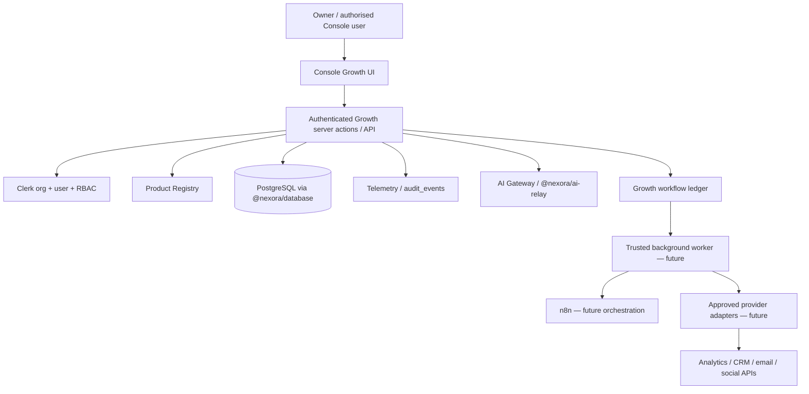

# NEXORA Growth Engine — delivery plan

**Status:** Active implementation plan  
**Last reviewed:** 2026-11-27  
**Repository:** `xsmartbartx/NEXORA`  
**Product surface:** `console.onenexora.com/growth`

## Executive decision

Implement Growth Engine as a first-party, organisation-scoped module of the existing NEXORA Console. Do not create another SaaS, user directory, product catalogue, billing ledger or analytics identity system.

The checked-in code already contains a substantial P0 foundation:
- Campaign CRUD for creation/listing, backed by `growth_campaigns`.
- Versioned content drafts, immutable content versions and approval requests/decisions.
- AI-assisted draft generation through the server-side `@nexora/ai-relay` package, with entitlement and organisation rate-limit checks.
- Authenticated lead register, first/last-touch capture and lifecycle state reporting.
- Operational analytics for campaigns, content, approvals, AI draft activity and lead metadata quality.
- Integration provider catalog/adapter contracts, a validated n8n configuration adapter and persistence for integration connections/workflow runs.

This plan treats those components as existing implementation, not future work. It does not claim that external provider execution, publishing, CRM/email synchronization, source metric ingestion or financial attribution are operational.

## 1. Existing architecture — preserve these boundaries

| Concern | Existing NEXORA owner | Growth integration rule |
|---|---|---|
| Authentication and organisation | `@nexora/auth` / Clerk | Resolve active org and user server-side on every operation |
| Product truth | `@nexora/registry` | Store stable product slug; read metadata/lifecycle from registry |
| Persistence | `@nexora/database` | No direct app-level Postgres drivers; every tenant query filters `org_id` |
| Audit and usage | `@nexora/telemetry` / `audit_events` | Record security-sensitive mutations, never credentials or unnecessary PII |
| AI providers | `@nexora/ai-relay` / AI Gateway | Server-side only; enforce entitlement, rate limits and model allow-list |
| Workflow integration | `@nexora/integrations` and n8n adapter | Contracts are not live connectivity; workflow execution remains disabled until worker and security controls exist |
| UI | `apps/console` | Keep Growth inside the existing authenticated Console shell |

### Target request/data flow

PostgreSQL is the durable business system of record. n8n is an execution/orchestration system only. Provider callbacks must return through a validated NEXORA boundary; they must not mutate Growth tables directly.

## 2. Module status and deliverables

| Module | Current verified code surface | Next implementation focus |
|---|---|---|
| Overview | `/growth` | Workflow health and data freshness; distinguish unavailable metrics |
| Products | Product Registry link/read | Organisation-specific growth profiles (ICP, positioning, claims, proof references) |
| Campaigns | `/growth/campaigns` | Edit/archive, channels, audience, success metric, UTM templates |
| Content Studio | `/growth/content` | Version compare/edit, source evidence, structured outputs, editorial checks |
| Approvals | `/growth/approvals` | Approval history, approver permissions, per-channel exact-version approval |
| Analytics | `/growth/analytics` | Trusted imports and metric definitions; no unsupported business KPI claims |
| Reports | Planned | Persisted snapshots with source timestamps and caveats |
| Acquisition & Leads | `/growth/leads` | Privacy lifecycle, stage history and optional trusted CRM synchronization |
| Integrations | Existing package/schema foundation | Secure connect/disconnect lifecycle, secret manager, tested scopes |
| Automation | Workflow DB ledger + n8n config contract | Worker, signature verification, retries, dead-letter queue and run visibility |

## 3. Data model: reuse before extending

Existing migration history includes:
- `0010_growth_engine_p0.sql`: campaigns, content, versions, approvals.
- `0011_growth_acquisition_attribution.sql`: leads and touchpoints.
- `0012_growth_integrations_workflows.sql`: integration registry and workflow run ledger.

Existing schema exports include `growthCampaigns`, `growthContentItems`, `growthContentVersions`, `growthApprovals`, `growthLeads`, `growthLeadTouchpoints`, `growthIntegrations` and `growthWorkflowRuns`.

Do not introduce duplicate versions of these records. Before adding tables, compare the requested field against the existing Drizzle schema and migration journal.

### Candidate entities still required (after a schema review)

| Entity | Responsibility | Important constraints |
|---|---|---|
| `growth_product_profiles` | Tenant-owned ICP, positioning, use cases, evidence and approved claims | Unique `(org_id, product_slug)`; product slug must resolve to Product Registry |
| `growth_campaign_channels` | Channel-specific destination, UTM policy and target | FK to campaign; constrained channel; tenant scoped |
| `growth_media_assets` | Object-storage references and metadata | No binary blobs or public credentials in Postgres |
| `growth_metric_daily` | Validated daily aggregate metrics | Unique dimensions; metric definition, currency, source and freshness |
| `growth_reports` | Reproducible weekly/monthly snapshots | Immutable snapshot + source version/timestamp |
| `growth_lead_stage_events` | Historical stage transitions | Append-only; records actor/time and prior/new stage |

Add each only when an actual UI/API use case exists. Keep raw behavioural events in PostHog or the source analytics system; persist validated aggregates and minimal attribution.

## 4. Recommended delivery order

### G7 — Product profiles and campaign completeness
1. Add registry-backed product profile editing, scoped to active organisation.
2. Include ICP, target roles/segments, problem statements, positioning, evidence links and approved claims.
3. Add campaign editing/status transitions, audience, channels, destination, UTM parameters, target metric and owner.
4. Validate product lifecycle at draft and approval time; beta products must not be described as generally available.
5. Audit each mutation and add cross-organisation isolation tests.

**Acceptance:** a campaign is traceable to one registry product, audience, channel, UTM convention and measurable target; profile claims are linked to evidence and reviewed.

### G8 — Content quality and approvals
1. Add content revision UI that creates a new immutable version instead of mutating an existing version.
2. Render a version diff and show AI-generated/source evidence metadata.
3. Persist approval decision history against the exact content version and intended channel.
4. Add role checks so content creators cannot silently self-approve high-impact external actions unless policy explicitly permits it.
5. When content changes, invalidate approval for the prior version; approval never transfers to a newer version.

**Acceptance:** any approved asset has a stable version ID, channel, reviewer, timestamp and auditable decision. A modified draft requires a new approval.

### G9 — Reporting snapshots
1. Add `growth_reports` for weekly/monthly snapshots.
2. Capture reporting window, generation time, source timestamps, schema version, aggregation logic version and quality notes.
3. Derive operational metrics from NEXORA records and imported metrics from validated connectors.
4. Distinguish actuals, estimates and unavailable values in all reports.
5. Export CSV/JSON first; PDF only after the underlying snapshot is stable.

**Acceptance:** the same stored snapshot can be reproduced and its source coverage explained.

### G10 — Integration connection lifecycle (read-only first)
1. Implement connect/disconnect and health-check lifecycle for one provider at a time.
2. Resolve credentials exclusively from a managed secret service via opaque `credential_ref`; never store tokens in Postgres, browser state, n8n payloads or logs.
3. Request least-privilege scopes and verify the actual granted scope set.
4. Restrict outbound networking to explicit provider host allow-lists; defend against SSRF, DNS rebinding and redirects to private networks.
5. Start with read-only GitHub release metadata and PostHog aggregate metrics; do not enable message sending or social publishing.

**Acceptance:** a tenant can connect/disconnect an integration, check its status and revoke it without exposing the provider secret. Each API call is logged with safe metadata.

### G11 — Workflow runtime and n8n (no external side effects initially)
1. Add a trusted worker that claims `queued` rows atomically (e.g. `FOR UPDATE SKIP LOCKED`).
2. Re-validate organisation, run, integration, scope and resource ownership immediately before execution.
3. Sign NEXORA-to-n8n events and verify n8n callbacks; enforce timestamp tolerance, nonce/delivery replay protection and schema version.
4. Implement bounded exponential backoff with jitter, timeouts, retry classification and dead-letter state.
5. Make provider/network calls idempotent. Persist sanitized error codes only.
6. Expose run status, duration, attempts, last safe error code and retry action in Console.

**Acceptance:** retries do not duplicate records or side effects; cross-tenant run identifiers cannot be used to inspect or retry another tenant's workflows.

### G12 — Analytics and source-of-truth integration
1. Define canonical event names, IDs, product IDs, campaign IDs and timestamps.
2. Ingest PostHog, Search Console and later CRM/provider metrics through read-only adapters.
3. Store source, time zone, currency, metric definition, import timestamp, freshness and completeness.
4. Join billing subscriptions/revenue only through verified identifiers; keep billing authoritative for money.
5. Publish CAC, ROAS, conversion and retention only when numerator, denominator, cost window and attribution method are known.

**Acceptance:** every chart has metric definition, source, period, freshness and attribution caveat. No metric defaults silently to zero.

### G13 — Controlled outbound operations (last)
1. Add email/publishing adapters only for official, currently supported provider APIs.
2. Validate campaign status, exact content version, approval, recipient eligibility, consent and suppression immediately before dispatch.
3. Require explicit operator action and show an immutable preview of the exact outgoing payload.
4. Use provider idempotency keys, per-tenant quotas, a kill switch and delivery audit trail.
5. Keep pricing changes outside the content approval flow and require a separate privileged change proposal.

**Acceptance:** a publish/send operation cannot execute without all gates; failures are visible and do not falsely mark the action successful.

## 5. Core workflow definitions

| Workflow | Trigger | Processing | Persisted result | Guard |
|---|---|---|---|---|
| WF-01 GitHub Release Monitor | Verified release event | Match allowlisted repo and registry product; create candidate | Workflow run + content/idea candidate | Signed webhook + repository allow-list |
| WF-02 AI Content Draft | User submits brief | Build constrained prompt through AI Gateway | Immutable draft version + provider/model metadata | Entitlement, rate limit, [VERIFY] claims |
| WF-03 Channel Adaptation | User selects target channel | Adapt approved base draft to format | New draft version per channel | New approval per version/channel |
| WF-04 SEO Draft | Approved article brief | Build article structure and factual checklist | Article draft and source refs | Evidence review |
| WF-05 Content Calendar | Owner requests schedule suggestions | Suggest cadence from capacity and campaign goals | Proposed calendar entries | Human confirms dates |
| WF-06 Metrics Import | Scheduled read-only sync | Fetch aggregates, validate schema and freshness | Daily metric rows + import run | Provider scope and source timestamps |
| WF-07 Lead CRM Sync | Consented lead event | Upsert minimum permitted fields | CRM mapping status | Consent and suppression check |
| WF-08 Lifecycle Event | Product/billing event | Resolve transactional eligibility and approved template | Delivery request/result | Transactional vs marketing separation |
| WF-09 Activation Cohort | Product telemetry aggregate | Aggregate cohort outcomes | Cohort report data | Minimum cohort threshold / privacy |
| WF-10 Weekly Report | Weekly schedule | Snapshot metrics and source coverage | Immutable report snapshot | Owner review |

## 6. Analytics definitions and guardrails

| Metric | Definition | Publish condition |
|---|---|---|
| Traffic | Source-defined sessions over a UTC reporting window | Connector source and session definition known |
| Leads | Distinct lead records created in reporting window | Deduplication policy documented |
| Qualified leads | Distinct leads whose current or historical status meets explicit criteria | Qualification criteria and time semantics defined |
| Signup conversion | Attributable signups / attributable eligible sessions | Matching IDs and denominator completeness known |
| Activation | New accounts completing the product-specific first-value event | Product event definition and cohort window known |
| Paid conversion | Eligible trials/free accounts entering a paid subscription | Billing event is authoritative and join key verified |
| CAC | Fully allocated acquisition spend / new paying customers | Cost allocation and customer attribution complete |
| ROAS | Attributed revenue / paid media spend | Billing/refund and ad spend sources reconciled |
| Churn | Customers/subscriptions lost during a defined period / eligible starting base | Subscription status semantics and period basis defined |
| Retention | Cohort members meeting a defined activity or billing condition / initial cohort | Cohort definition and event completeness documented |

Never infer attribution from a page view alone. First-touch and last-touch lead counts currently available from touchpoints are not revenue attribution and must be labelled accordingly.

## 7. Security, privacy and operational requirements

- Tenant scoping is server-side and repeated in every data query; never accept `org_id` as authority from the browser.
- Use RBAC for product profiles, campaign edits, exports, integrations, approvals and workflow retries.
- Keep credentials in secret management; database `credential_ref` is only a locator.
- Sanitize logs and telemetry; never log content prompts, raw provider payloads, tokens or lead email addresses.
- Separate analytics identifiers from direct contact identifiers; establish retention/deletion and consent handling before person-level tracking.
- Webhook signatures, replay windows and idempotency are mandatory.
- External publishing/email is disabled until G13 acceptance is met.
- Apply database migrations through the existing Drizzle journal/process; never edit production tables manually.
- Back up PostgreSQL and test restore before introducing higher-volume metrics or reports.

## 8. Release gates

### Growth P0 — Internal operations
- [x] Existing org-scoped campaign/content/approval foundation
- [x] Existing AI draft generation through NEXORA Gateway
- [x] Existing lead register and basic UTM touchpoints
- [x] Existing operational analytics
- [ ] Product growth profiles
- [ ] Campaign channels, audience and target metrics
- [ ] Content revision and evidence UX
- [ ] Report snapshot persistence
- [ ] Integration connection UI and secret manager
- [ ] Workflow run visibility and retry policy

### Growth P1 — Connected measurement
- [ ] Read-only GitHub release connector
- [ ] Read-only PostHog/Search Console metric import
- [ ] Verified billing/product event joins
- [ ] Revenue/CAC/conversion/retention definitions and reporting

### Growth P2 — Controlled automation
- [ ] n8n worker and callback boundary
- [ ] Channel-specific content approval
- [ ] CRM/email adapters with consent/suppression controls
- [ ] Official social publishing adapter where permitted
- [ ] Operational kill switch and audit of external actions

## 9. Operational sequence for this repository

1. Read `docs/NEXORA-PLATFORM-ARCHITECTURE.md` and `docs/adr/ADR-0014-growth-engine-boundary.md`.
2. Reuse the existing schema and package boundaries; inspect migration journal before each DB change.
3. Implement a small, vertical slice with its UI, server action, migration, tests and docs in one PR.
4. Run `npm run typecheck`, `npm run lint`, the relevant Vitest tests and relevant build workspaces.
5. Verify isolation with two test organisations and verify denied access with an invalid role/session.
6. Deploy to staging, apply migration through the normal pipeline, and validate the complete UI-to-DB path.
7. Promote only after acceptance checks and rollback instructions are recorded.

## 10. Immediate next slice

Prioritise **G7.1 Product Growth Profiles**. It is the smallest strategic gap: the platform already has product metadata, campaigns and AI drafting, but no tenant-owned, evidence-based positioning context. The profile becomes reusable input for campaign briefs, prompt construction and content verification.

Do not start with automated publishing. First make the content accurate, attributable and governed; then automate repeatable execution.
