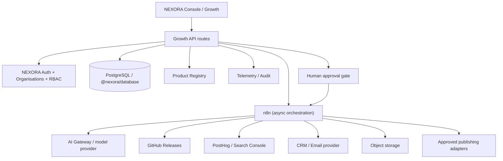

# NEXORA Growth Engine

**Status:** Proposed implementation baseline  
**Owner:** NEXORA Platform  
**Scope:** Internal growth operations for the NEXORA product portfolio  
**Branch:** `feat/growth-engine-foundation`

## 1. Product decision

Build Growth Engine as a first-party, organisation-aware workspace inside the existing NEXORA Console. Do not create a second identity system, a separate customer database, or a parallel product catalogue.

The public website and Product Registry remain the source of truth for public product metadata. Growth Engine owns campaign operations, editorial assets, approvals, attribution metadata and aggregated marketing performance.

### Initial portfolio context

The current public portfolio presents products across AI, Security, Cloud and Developer categories. The website currently lists Linegist/Sentinel, CSPM, AI Gateway, Vigilo, NeuraWall, CodeReviewer, Prism and AUREX. Product lifecycle and availability must always be read from the Product Registry; a marketing record must never imply that a beta product is generally available.

## 2. Architecture

### Boundary rules

- Console is the authenticated user interface and follows the existing shared shell.
- Growth API is the only application boundary allowed to mutate Growth records.
- PostgreSQL access remains inside `@nexora/database`; no app imports a database driver directly.
- Organisation identity comes from NEXORA Auth/Clerk. Every tenant-owned row includes `org_id`; every query is organisation-scoped.
- Product references use stable Product Registry IDs/slugs. Do not duplicate product descriptions, lifecycle or pricing as authoritative data.
- n8n is an execution system, not the source of truth. Persist workflow intent, run state and idempotency keys in NEXORA.
- AI Gateway is the only model-provider boundary. Provider keys are not stored in Growth tables or workflow payloads.
- External integrations use least-privilege OAuth credentials or managed secrets. Never expose credentials to browser code, prompts, logs or content records.
- Publishing, outbound email and pricing changes require explicit human approval in the first release.

## 3. First release (P0)

Deliver only these modules:

1. **Overview** — portfolio health, active campaigns, pending approvals, recent workflow failures and attributable outcomes.
2. **Products** — read-only Product Registry view plus editable growth profile (ICP, use cases, proof points, positioning, approved claims).
3. **Campaigns** — objectives, audience, product, channels, dates, budget, UTM policy and success metric.
4. **Content Studio** — briefs, AI-assisted drafts, versions, claims/evidence, assets and campaign association.
5. **Approvals** — immutable approval decisions tied to a specific content version and intended channel.
6. **Analytics** — imported/aggregated channel and product events, attribution and funnel reporting.
7. **Reports** — scheduled weekly/monthly snapshots with source timestamps and data-quality notes.

Explicitly defer social calendar automation, SEO keyword research, video production management, CRM lifecycle automation, email sequences, pricing experiments, competitor monitoring and partner workflows until the P0 data model and approval path are proven.

## 4. Data model

All timestamps are UTC. IDs are UUIDs unless a stable external identifier is required. All tenant-owned tables include `org_id` and indexes beginning with `org_id`.

| Table | Key fields | Purpose |
|---|---|---|
| `growth_product_profiles` | org_id, product_slug, icp, positioning, use_cases, proof_points, approved_claims, updated_by | Organisation-specific growth context referencing Product Registry |
| `growth_campaigns` | org_id, product_slug, name, objective, status, start_at, end_at, budget_minor, currency, owner_id | Campaign plan and lifecycle |
| `growth_campaign_channels` | org_id, campaign_id, channel, destination, utm_source, utm_medium, utm_campaign | Channel configuration and UTM mapping |
| `growth_content_items` | org_id, campaign_id, product_slug, type, title, status, owner_id, scheduled_at | Logical content item |
| `growth_content_versions` | org_id, content_item_id, version, body, metadata, source_refs, created_by | Immutable content revisions and evidence |
| `growth_media_assets` | org_id, storage_key, mime_type, size_bytes, checksum, metadata, uploaded_by | References to media in object storage; no binary blobs in Postgres |
| `growth_approvals` | org_id, content_version_id, channel, decision, decided_by, decided_at, comment | Version-specific approval/rejection history |
| `growth_workflow_runs` | org_id, workflow_key, idempotency_key, external_run_id, status, input_ref, output_ref, started_at, finished_at, error_code | Durable workflow execution state |
| `growth_metric_daily` | org_id, product_slug, campaign_id, channel, metric_date, metric_key, metric_value, currency | Daily aggregated performance metrics |
| `growth_attribution_touchpoints` | org_id, anonymous_id_hash, pseudonymous_user_id, campaign_id, source, medium, occurred_at | Pseudonymous attribution touchpoints with retention policy |
| `growth_reports` | org_id, period_start, period_end, report_type, snapshot, generated_at, generated_by | Reproducible report snapshots |

Use existing platform audit events for security-sensitive actions where appropriate. Add domain-specific audit actions for campaign edits, content generation, approval decisions, integration changes and export operations. Do not create a second user or organisation table.

### Data protection

- Store only data needed for campaign operations and measurement.
- Keep raw behavioural events in the analytics system where possible; persist aggregates and pseudonymous attribution references in Growth.
- Do not place customer content, secrets, access tokens, payment data or sensitive personal data in prompts or analytics properties.
- Apply consent and lawful-basis checks before marketing email processing; keep suppression/unsubscribe state authoritative in the email provider or CRM and synchronise it safely.
- Define retention and deletion jobs before enabling person-level attribution.
- Treat generated claims as unverified until linked to an approved source or product evidence.

## 5. Workflow contracts

Each n8n workflow is triggered by a signed, authenticated event and carries `event_id`, `org_id`, `actor_id`, `occurred_at`, `schema_version` and a minimal resource reference. Validate the organisation and resource again when processing. Use an idempotency key for every side effect.

| ID | Workflow | Trigger | Output | Gate |
|---|---|---|---|---|
| WF-01 | GitHub Release Monitor | Verified release webhook | Candidate product update | Human selects campaign relevance |
| WF-02 | AI Content Draft | Content brief submitted | Versioned draft + source references | Draft only; never publish |
| WF-03 | Channel Adaptation | Approved base draft | Channel-specific variants | Approval per final variant |
| WF-04 | SEO Draft | Approved article brief | Article draft + evidence checklist | Editorial/fact-check approval |
| WF-05 | Content Calendar Builder | Weekly schedule request | Suggested schedule | Owner confirms |
| WF-06 | Campaign Metrics Import | Scheduled connector sync | Daily metric aggregates | Data-quality validation |
| WF-07 | Lead Event Sync | Consented lead event | CRM upsert | Duplicate and consent checks |
| WF-08 | Transactional Lifecycle Event | Product lifecycle event | Provider message request | Template and eligibility checks |
| WF-09 | Activation Cohort | Product telemetry aggregate | Cohort summary | Aggregate-only reporting |
| WF-10 | Weekly Growth Report | Weekly schedule | Report snapshot | Owner review |
| WF-11+ | Video, competitor, pricing, partner workflows | Deferred | Deferred | Separate design review |

### Release-to-campaign flow

1. GitHub sends a signed release webhook.
2. Growth API validates signature, repository allowlist and delivery ID.
3. An idempotent event is recorded and a WF-01 run is queued.
4. n8n retrieves the release metadata and changelog through a scoped GitHub connection.
5. AI Gateway produces a structured summary with source references and uncertainty markers.
6. A draft content item is created; it is not scheduled or published.
7. A human edits and approves each channel-specific version.
8. A publishing adapter executes only the approved version and records provider response IDs.
9. Analytics imports campaign metrics and links them to campaign/product events.

## 6. API surface (proposed)

Use the existing API error envelope, authentication and rate-limiting conventions.

- `GET /v1/growth/overview`
- `GET|POST /v1/growth/products`
- `GET|POST /v1/growth/campaigns`
- `GET|PATCH /v1/growth/campaigns/:id`
- `GET|POST /v1/growth/content`
- `POST /v1/growth/content/:id/versions`
- `POST /v1/growth/approvals/:id/decision`
- `GET /v1/growth/analytics/summary`
- `GET /v1/growth/reports`
- `POST /v1/growth/webhooks/github-release`
- `POST /v1/growth/webhooks/n8n`

Do not expose generic SQL, arbitrary workflow execution or unrestricted proxy endpoints.

## 7.1 Current implementation checkpoint

The first Console vertical slice is present on `feat/growth-engine-foundation`:

- `/growth` is an authenticated route protected by `requireOrg()`.
- The global Console navigation exposes **Growth**.
- The dashboard reads the product count from Product Registry.
- Campaign, approval, revenue and n8n metrics are explicitly marked unavailable until their data sources are connected; no demo values are presented as production metrics.
- Products and the existing Analytics surface are linked; remaining P0 modules are shown as planned rather than routing to unfinished pages.

This is a UI foundation, not a claim that campaign CRUD, database persistence, AI generation or provider integrations are complete. Those require the G1–G4 implementation slices below.

## 7. Delivery sequence

### G0 — Contracts and foundations
- ADR approval, threat model, RBAC matrix and event schemas.
- Confirm existing Console route conventions and shared UI components.
- Define migration ownership and organisation isolation tests.
- Define n8n deployment, webhook authentication and secret rotation.

### G1 — P0 vertical slice
- Growth navigation and Overview shell.
- Product profiles read from Product Registry.
- Campaign CRUD and channel mapping.
- Content items, immutable versions and media references.
- Version-specific approval flow and audit events.
- No external publishing.

### G2 — AI + GitHub automation
- AI Gateway integration with structured output and prompt versioning.
- Signed GitHub release ingestion.
- n8n WF-01/WF-02 with retries, idempotency and dead-letter handling.
- Human approval queue.

### G3 — Analytics + reports
- UTM conventions and event contract.
- PostHog/Search Console import adapters.
- Daily metric aggregation, source freshness and attribution caveats.
- Weekly report snapshots.

### G4 — Controlled external actions
- CRM/email adapters with consent/suppression enforcement.
- Social publishing adapters only where official APIs and permissions support the action.
- Per-channel approval, rollback/withdrawal procedure and delivery audit.
- Additional workflows only after operational review.

## 8. Definition of done

- Cross-organisation access tests prove no Growth data leaks between organisations.
- Every mutation is authenticated, authorised and audited.
- Webhooks are signature-verified, replay-safe and idempotent.
- AI outputs are drafts, source-linked and schema-validated.
- No external publication or marketing send occurs without an approval record for the exact version.
- Failed workflow runs are visible, retryable and have a dead-letter path.
- Metrics show source, time window, currency and freshness; unknown attribution is not silently treated as direct.
- Migrations, tests, docs and operational runbooks ship with each phase.
- No new secret is committed to Git or stored in application tables.

## 7.2 G2 implementation checkpoint — campaign, content and approval foundation

The first persisted Growth slice is implemented in \`packages/database\` and the Console:

- \`growth_campaigns\` stores organisation-owned campaign briefs, scheduling windows, optional integer minor-unit budgets and lifecycle status.
- \`growth_content_items\` stores content metadata and references Product Registry records by slug. Campaign references are nullable and protected by a database foreign key.
- \`growth_content_versions\` stores immutable body snapshots with monotonically increasing version numbers per content item, source-reference JSON and organisation ownership.
- \`growth_approvals\` stores review decisions against an exact content-version ID. A partial unique index allows at most one pending approval per version.
- Campaign creation, draft creation, approval requests and review decisions are server actions. Each action obtains the active organisation and user from \`requireOrg()\`, scopes reads and writes by \`org_id\`, validates user input and emits an audit event.
- The Console now exposes \`/growth/campaigns\`, \`/growth/content\` and \`/growth/approvals\`. Dashboard links point to these implemented surfaces.
- Campaign/content creation and approval are data-only operations. They do not publish, send email, alter pricing or invoke n8n. External actions remain behind a future explicit approval-and-execution boundary.

Database migration: \`0010_growth_engine_p0.sql\`. The schema intentionally keeps Clerk organisation/user identifiers as text references by convention; those identities are not owned by the application database. The relational foreign keys inside Growth protect campaign/content/version relationships, while every application query still applies organisation scope.

### G2 acceptance boundary

This slice is a functional persistence and review foundation, not the complete Marketing Engine. It does not yet include campaign editing/archiving, content revision UI, source citation ingestion, AI Gateway generation, n8n execution, channel publishing, analytics attribution or report generation. The migration must be applied to the target PostgreSQL database before the new screens can perform reads and writes. Runtime database availability and migration execution are environment-dependent and are not implied by CI.

## 7.3 G3 implementation checkpoint — AI-assisted content drafts

The NEXORA Gateway relay has been extracted into the server-side workspace package `@nexora/ai-relay`. The existing Gateway route and first-party Growth Console workflow now use the same relay implementation, model allow-list, request-size limits and provider credential contract.

The Content Studio now provides an AI draft generator that:

- Requires an authenticated organisation and checks the existing `gateway.proxy` entitlement before a model call.
- Builds a constrained prompt from the user brief, selected channel, content type, Product Registry identity and an organisation-scoped campaign objective.
- Instructs the model not to invent product capabilities, pricing, customer proof, metrics or guarantees; missing facts must be marked `[VERIFY]`.
- Calls the server-side NEXORA AI relay. The upstream key remains a server environment secret and is never sent to the browser or stored in Growth records.
- Persists the model output as version 1 of a normal Growth content item, with minimal provider metadata in `source_refs`.
- Emits Gateway usage and Growth audit events. The prompt itself is not written to audit metadata.

The generated item remains a draft and must pass the existing version-specific approval flow. No publish, email, ad or pricing action is connected.

**Runtime requirement:** the Console deployment must have the same managed `GATEWAY_UPSTREAM_API_KEY` and compatible Gateway model/limit configuration as the Gateway deployment. The variable is documented in `apps/console/.env.example`; it must be configured in the deployment secret manager, not committed to Git.

This is an AI-assisted draft workflow, not yet a multi-provider router, prompt-template registry, source-grounded research system or autonomous publishing agent. Provider routing and richer evidence ingestion remain separate follow-up work.
